# GitHub 新手投稿教程

本教程适合想入门 GitHub 的新手，或者整理合并 [投稿区](https://github.com/lin-alg/NaiLoong/issues/1) 表情的贡献者。

> 有任何疑问，可以将这个文档和你的问题喂给AI，如果还是无法解答，可以直接提Issue咨询

如果你只想在投稿区上传表情，看 [社区投稿指南](meme-submissions.md) 即可。如果你是第二次投稿，请看 [再次投稿步骤](#再次投稿怎么操作) 。

## 本地表情编辑器（补充流程）

如果嫌文字教程太长，可以先看[交互式 Git 教程](../contribute.html)，有不清楚的地方再回来看对应部分。

完成 Fork 和工作分支准备，并把图片推送到自己的 `image` 分支后，切回 `meme/...` 投稿工作分支，在仓库根目录运行：

```bash
python scripts/data_editor.py data
```

会在浏览器打开本地编辑器，扫描 `image` 分支上最新的commit；如本次图片分成多个 commit，可指定最近 N 个。新增图片会自动带入 URL 和动图/静态图分类；替换或重命名图片会显示新旧差异并匹配已有记录。删除图片会先提示，默认保留网站记录。确认整理后，编辑器会校验并写入数据。

AI 标注支持 OpenAI、Anthropic 和 Google Gemini 的官方 API；需本机先安装 [ffmpeg](https://ffmpeg.org/download.html) 并加入到 PATH 中才能处理动画。动画转为完整 MP4；OpenAI / Anthropic 使用去掉近似重复画面后的代表帧，Gemini 使用视频。AI 参考角色图片和标签定义生成建议，结果需人工核对。API key 只用于本次请求，不会保存。

编辑器会根据image分支自动生成图片的URL，可手工补齐标题与标签，也可先使用 AI 建议。第五节介绍这套浏览器流程；运行 `python scripts/data_editor.py --tk data` 命令可启动旧 Tk 编辑器。

## 一. 初识 Git

>如果你已经了解 Git 的使用，可以跳到[安装-git-并创建-fork](#二-安装-git-并创建-fork)

Git 本质上就是一个用于保存项目代码的不同版本，并追踪版本历史的工具。

### 1. 本地操作：add 和 commit

我们在本地写了一段代码很满意，想要记录这次修改，就需要保存一个新的版本，这个动作叫 **`commit`（提交）**。我们首先想到的是把整个项目文件夹添加为一个压缩包并用版本号命名，但是这样不仅占空间，而且还不方便管理。所以 commit 只记录文件变化了的部分。

我们不一定想把当前改动的所有文件都一次性存进去，可能只想存一部分，剩下的留到下个版本再提交。这时候就需要先用 **`add`** 把想要提交的文件放到“暂存区”，然后再 `commit` 暂存区里的修改。

---

### 2. 远程同步：push 和 pull

代码只保存在自己电脑上还不保险，或者要跟别人协作，就需要用到远程仓库（比如 GitHub）：

- 我们需要把本地的 commit 上传到远程仓库，就 **`push`（推）**。
- 我们需要把远程仓库的 commit 下载到本地，就 **`pull`（拉）**。

---

### 3. 多人协作与代码冲突

假设我们和同事正在开发 GitHub 上的同一个项目，两个人同时 pull 了仓库，得到仓库 main 分支上的最新版本。

main分支结构：
```
B --> A (B是最新的commit，指向A)
```
同事先改好代码，把本地的 `commit C` 推到了远程仓库。这时我们本地也做了一些改动想要提交 `commit D`，远程仓库就会迷糊：**“我到底是听他的，还是听你的？”**

所以 Git 要求我们必须先 pull 下来同事的最新版本，在本地处理好冲突再上传。这时候我们常用的命令是：
```bash
git pull --rebase origin main
```
`--rebase` 的作用是将我们本地的 `commit D`直接“拔起来”，追加在他的 commit 后面。

我们本地的分支结构原本是：

```
D --> B --> A
```

pull 下来远程的仓库之后，变成这样：

```
D
└ - C --> B --> A
```
此时 D 还未完全接在 C 上，会遇到两种情况：

- **情况 1**：如果我们和另一个人修改的位置不同，Git 会自动处理好，历史上看起来就是先后发生的两个版本。
  ```
  D --> C --> B --> A
  ```
- **情况 2**：如果我们和另一个人修改了相同的地方（比如都改了 `main.py` 里的 A 函数），rebase 就会停下来红字提示冲突：
  ```text
  CONFLICT (content): Merge conflict in main.py
  ```

此时打开编辑器，会有类似这种标记：

> 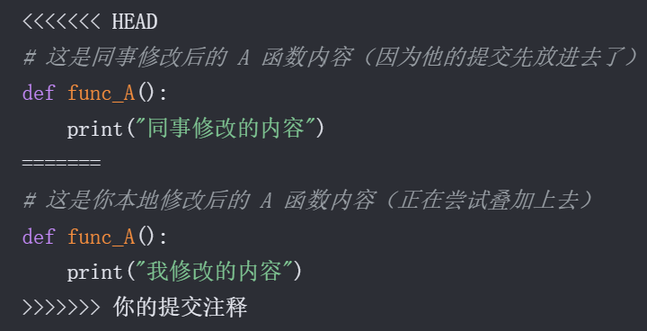

我们需要人工做决策：到底是保留他的、保留我们的，还是结合一下给出最终版本？现代编辑器都可以很方便地点击按钮来选择。

处理完冲突并保存文件后，先运行 `git add main.py`（替换为实际解决冲突的文件），再运行 `git rebase --continue`；也可在 VS Code 的源代码管理面板暂存后点“继续”。重复操作直到所有冲突解决完毕，我们的 commit 就顺利接在最前面了。
```
  D --> C --> B --> A
```

---

### 4. rebase 和 merge 有什么区别？

你可能也听说过 `git merge`，它和 `rebase` 有什么区别呢？

- **rebase（变基）**：能保持提交历史是**一条直线**。它把你的修改拆下来，放到目标分支的最新节点之后，看起来像是在最新版本上顺理成章做出的改动。
- **merge（合并）**：会保留原始的分叉历史。它会新建一个特殊的“合并节点”`E`，把两个分叉再合并在一起。

如图所示：
```
┌-----D-----┐
↑           ↓
E --> C --> B --> A
```

---

### 5. 团队协作进阶：Fork 与 Pull Request（PR）

在实际 GitHub 开源项目或团队协作中，主仓库通常受到保护，大家不能直接往 `main` 分支上 `push` 代码。这时候的标准流程是：

1. **Fork**：在 GitHub 页面上点击 Fork，把别人的主仓库完整复制一份到你自己的账号下。
2. **修改并推送**：把代码 clone 到本地修改，commit 之后，push 到**你自己账号下的仓库（一般命名成origin）**。
3. **提 PR（Pull Request）**：去 GitHub 页面发起一个 Pull Request。这句话的意思其实就是向项目管理员喊话：“*我写好了新功能/修好了 Bug，请求（Request）你把我的代码拉（Pull）到你们的主仓库（一般命名为upstream）里！*”
4. 管理员审核通过后点击同意，你的代码就正式并入项目主干了。

---

### 术语速查

- **仓库（repository）**：存放项目文件和所有版本修改记录的地方。
- **Fork**：复制源仓库到自己的 GitHub 账号下。本文中 `origin` 指你自己的 Fork 副本，`upstream` 指原始的主仓库（如 `lin-alg/NaiLoong`）。
- **分支（branch）**：一组独立的版本线。`main` 是默认的主分支。
- **Commit**：把暂存区的修改保存为一个版本，你可以理解成拍了一张“快照”。
- **Push**：把本地的新版本推送到远程 GitHub 仓库。
- **Pull**：把远程仓库的新版本拉取合并到本地。
- **Pull Request（PR）**：请求主仓库的维护者把你的分支修改合并到主仓库中。

除了main分支，本项目中你还会在自己的 Fork 仓库上使用两种分支：

| 分支 | 用途 | 是否向主仓库发 PR |
| :--- | :--- | :--- |
| `image` | 长期保存原图 | 否 |
| `meme/naiwa-laugh` 等工作分支 | 提交这次投稿的 JSON 记录 | 是，合并到主仓库 `main` |

此外，会下载主仓库的 `preview` 分支到旁边的本地工作目录，供上传前筛查相似图使用。它由主仓库生成，无需推送到自己的 Fork。

## 二. 安装 Git 并创建 Fork

1. Windows 用户安装 [Git for Windows](https://git-scm.com/downloads/win) 。下文所介绍的命令都在 Git Bash 中运行。
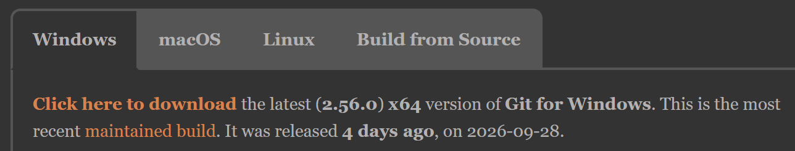

2. 登录 GitHub，打开 [lin-alg/NaiLoong](https://github.com/lin-alg/NaiLoong)，点击 **Fork → Create fork**。选项保持默认即可。
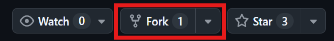
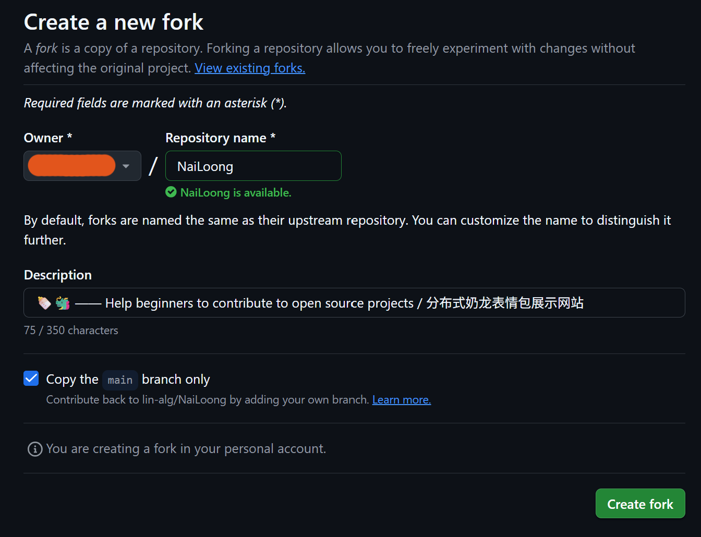


## 三. 克隆 Fork 仓库并同步主仓库

在你的 Fork仓库页面（注意不是主仓库！）点击"Code"，会弹出一个克隆链接，复制它：

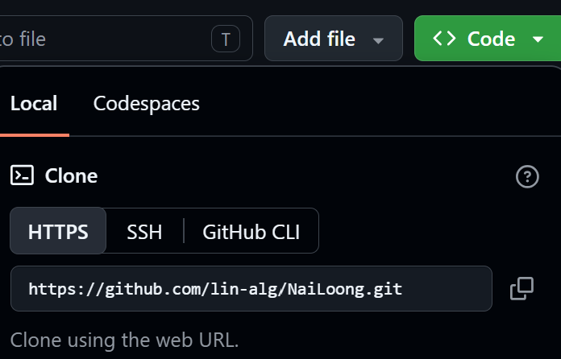

（这里仅为示例，实际链接应为`https://github.com/<你的用户名>/NaiLoong.git`）

在你的电脑上新建一个项目文件夹，然后在文件夹内右键，选择`Open Git Bash here`，打开窗口：

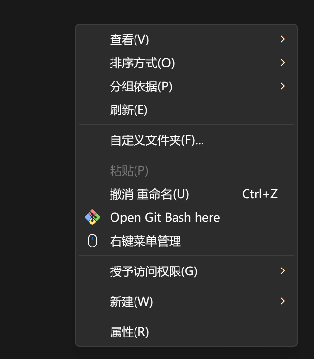
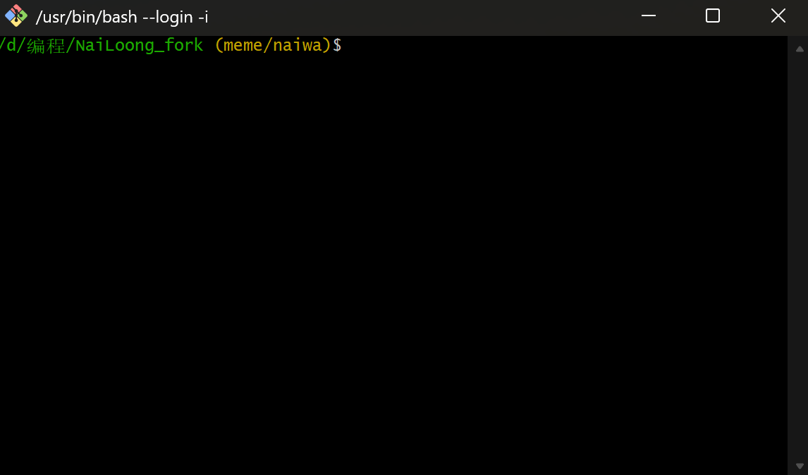

图中的绿色字体代表我们当前的工作目录，黄色字体为当前仓库的分支（初始化仓库后才会显示）。

在Git Bash窗口中依次执行以下命令：
```bash
git clone https://github.com/<你的用户名>/NaiLoong.git # 克隆仓库时会自动初始化仓库
cd NaiLoong # 进入NaiLoong文件夹
git remote add upstream https://github.com/lin-alg/NaiLoong.git # 添加主仓库到上游
git remote -v # 查看当前 Git 仓库所关联的远程仓库地址
```
> 由于克隆下来的仓库可能不是根目录，所以需要`cd NaiLoong`进入根目录。

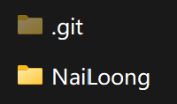
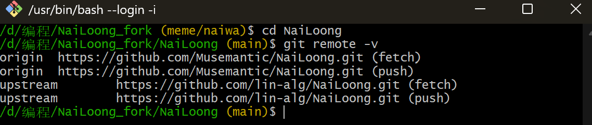
`origin` 应指向自己的 Fork，`upstream` 应指向 `lin-alg/NaiLoong`。后面的fetch、push分别指拉取和推送代码的远程地址，默认是相同的。

接着设置 commit 的署名，在 GitHub 的 **Settings → Emails** 处可以找到邮箱。

```bash
git config --global user.name "你的Github 用户名"
git config --global user.email "你的 GitHub 邮箱"
```

同步主仓库的最新内容：

```bash
git status
git fetch upstream main
git switch main
git merge --ff-only upstream/main
git push origin main
```

`status` 查看当前分支和改动，`fetch` 获取主仓库记录（仅获取main分支），`switch`切换分支，`merge --ff-only` 将刚才下载的 upstream/main 最新代码合并到当前的本地 main 分支，且强制使用快进模式。`push` 的作用是将更新推送到自己的远程仓库。首次 push 时，需按浏览器提示登录 GitHub 账号。
```
PS. Git的快进模式是什么？
ff-only 的全称是 fast-forward-only。目标分支包含当前分支的全部历史时，只需移动分支指针，就能快进。如果两边各有独立的新提交、历史已经分叉，命令会停下，不自动创建合并 commit。
```

## 四. 上传图片到 `image` 分支

准备静态图片或 GIF，单张严格不超过 **5 MB**，建议小于 2 MB。

处理投稿区图片时，选择“⚪ 未处理”的评论，右键另存为每张表情图片，保证下载的是原图，否则图片检查可能不通过。（你也可以不从投稿区选图，而是上传自己的表情。）

### 1. 准备本次新图与 Python

先在仓库外建立一个只放本次新图的文件夹，例如与 `NaiLoong` 并排的 `待投稿表情` 文件夹，把准备投稿的原图放进去。后面的 `../待投稿表情` 请替换成你的实际路径，保留引号；Windows 也可以填写 `"D:/图片/新表情"`。

安装 [Python 3.9 或更新版本](https://www.python.org/downloads/)，Windows 安装界面勾选 **Add Python to PATH**，然后检查：

```bash
python --version
```

应输出版本号。如果 Windows 的 `python` 打开微软商店，可以用 `py --version` 检查，并在后续命令中用 `py` 替换 `python`。

### 2. 下载预览并筛查相似表情

在当前 `main` 分支的仓库根目录，依次运行：

```bash
git fetch upstream preview
git worktree add --detach ../NaiLoong-preview upstream/preview
python -m pip install -r tools/meme-similarity/requirements.txt
python tools/meme-similarity/check.py "../待投稿表情" --previews "../NaiLoong-preview/previews"
```

`fetch upstream preview` 下载主仓库的预览分支。`worktree add` 把它展开到旁边的 `NaiLoong-preview` 文件夹，让代码与预览图能同时使用；`--detach` 表示只查看下载的版本，无需新建分支。当前目录仍在 `main`，预览分支**无需 push 到自己的 Fork**。Pillow 是筛查工具用于读取图片的依赖，只需安装一次。

工具递归比较新图文件夹与全部已有预览，使用 pHash 和 dHash；任一算法的距离不超过阈值就会标记，便于人工复核。运行后：

1. 打开新图文件夹中的 `_相似图筛查/<本次运行编号>/report.html`，并排查看新图与最接近的已有图。报告图片已嵌入，可以离线看；“查看已有原图”链接用于联网核对完整动图。
2. 疑似相似的新图旁会出现同名标记，例如 `meme.gif.疑似相似.txt`。原图的内容和文件名保持不变。
3. 核对文字、动作和表达含义后，自行删去不准备收录的新图。只将保留的原图用于下一步上传，报告与标记不用上传。

默认条件为 pHash 距离不超过 14 **或** dHash 距离不超过 12，距离越小画面越接近。动图只比首帧；裁剪、加边、镜像或预览尚未生成都可能导致漏检，未标记也需自行核对。若提示读取失败，先处理报告中的失败文件再重跑。阈值调整见[工具说明](../tools/meme-similarity/README.md#调整筛查范围)。

整理投稿区评论时，如果决定排除其中部分相似图，先请投稿者在“未处理”状态下编辑原评论，再按更新后的评论准备全部原图；认领一条评论的 PR 仍须包含该评论的全部图片。

### 3. 上传保留的原图

下面以 `meme.gif` 为例，介绍上传图片到 image 分支的流程。（image分支不要合并到其它分支！）

首先切换到image分支：
```bash
git switch -c image
```
在 `assets` 文件夹内建立 `memes` 文件夹，将筛查后保留的 `meme.gif` 复制进去，多个表情同理。

然后 add 所有表情文件并提交。
```bash
git add assets/memes/meme.gif
git status
git commit -m "feat: 添加新表情文件" # -m的意思是这次commit的说明
git push -u origin image # -u为分支设置默认推送地址，之后可以直接用git push。
git rev-parse HEAD # 获取这次commit的唯一标识，即哈希值。你也可以用git log命令，并记下最新的哈希。
```

**记下最后一条命令输出的 40 位 字符串**，这是图片上传 commit 的编号，供下一步的图片 URL 使用。图片URL的格式为：

```text
你的GitHub用户名/<40位commit哈希>/assets/memes/meme.gif
```

Github 用户名请填用户名而非昵称。比如下图括号中的名字即为用户名，左侧为昵称。

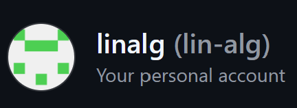

已有 `image` 分支时，无需重复创建，按 FAQ 中的 [再次投稿步骤](#再次投稿怎么操作) 操作即可。

> 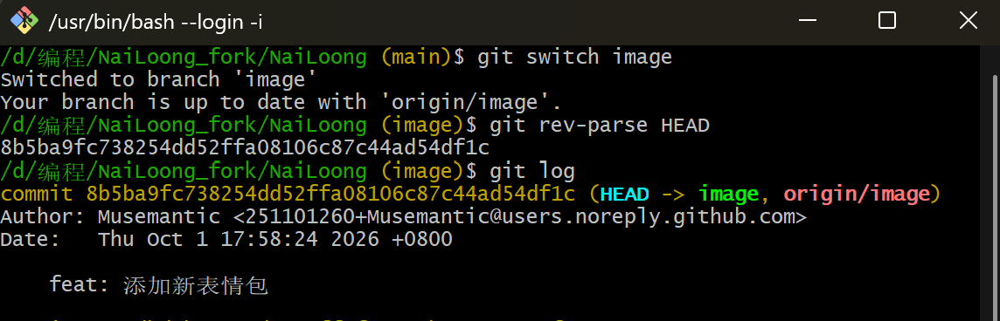

> 如图，commit 的哈希值为 8b5ba9fc738254dd52ffa08106c87c44ad54df1c
## 五. 创建工作分支并使用数据编辑器编辑表情数据

回到主仓库的最新数据，创建这次投稿的工作分支：

```bash
git switch main
git fetch upstream
git merge --ff-only upstream/main
git switch -c meme/naiwa-laugh
```

`meme/naiwa-laugh` 是示例分支名，你可以换成自己喜欢的，能描述本次投稿的分支名字。

### 1. 启动编辑器

第四节已安装 Python。浏览器编辑器只用 Python 标准库，无需另外安装包。只有选择旧版 `--tk` 编辑器时才需要 Tkinter；Linux 缺少它时，安装发行版提供的 `python3-tk`。

在仓库根目录运行下面的命令。命令最后的 `data` 是仓库里的数据文件夹，可以替换成你本地仓库的实际路径：

```bash
python scripts/data_editor.py data
```

Windows 也可以运行：

```powershell
py scripts/data_editor.py data
```

浏览器会打开本地地址（默认 <http://127.0.0.1:8765/>，端口被占用时自动换一个）。保持终端运行；关闭服务用 `Ctrl+C`。页面读取 `data/manifest.json`，角色、分类和标签选项来自当前数据。终端当前分支应为 `meme/...`。

### 2. 填写记录

1. 选择要扫描的最近 N 个 image commit，点击 **扫描 image 分支**。你在image分支上新提交了几个分支，N就填几。
2. 查看新增、更新 / 重命名和删除提醒。编辑器自动生成对应 commit 的图片 URL；原有条目会显示原图与新图的对比。删除图片时默认保留网站记录，只有明确勾选“同时从网站数据移除此条记录”才会删记录。
3. 勾选本次要写入的图片，为每条选择角色和分类，填写标题。分类会按动图 / 静态图匹配，仍需核对。
4. 为每个标签选择最合适的值；暂时无法判断时选择“未知”，保存为 `null`。
5. 可选：展开 **批量 AI 标注**，填写服务商、支持视觉和结构化输出的模型及密钥，点击开始。返回后逐项核对；已有条目的角色、分类和标签会保留。
6. 点击 **确认并写入数据**。编辑器校验全部数据，失败时自动恢复本次写入；成功后显示实际修改文件及提交命令。

扫描读取本地 `image`，不会自动 fetch 或推送。先确认图片已推到自己的 Fork 仓库；编辑器写入的是当前 `meme/...` 分支的 JSON。扫描后若外部修改了 image 分支或当前分支，请重新扫描并复核。

想使用旧版编辑器，可使用 `python scripts/data_editor.py --tk data`。旧版支持角色与分类的新增、修改和删除；支持新增标签、重命名标签和修改标签翻译，新增标签会给已有条目补入 `null`。图片 URL 可粘贴完整 GitHub blob / RAW 地址，保存时自动转为紧凑格式。

### 3. 在本地运行检查

编辑器保存时已经自动校验数据；提交前仍建议在仓库根目录运行一次完整的 Python 检查：

```bash
python scripts/validate_data.py
python -m unittest discover -s tests -v
```

第一条检查 `data/` 的结构、标签和图片 URL 是否规范，第二条运行项目的 Python 自动化测试。它们都只使用 Python 标准库，不需要 `pip install`。

## 六. 提交并创建 PR

下面以新增奶蛙动图为例；分支名和编辑器实际修改的分类文件要换成自己的值。

```bash
git status
git add data/naiwa/animated.json # naiwa指奶蛙角色，animated指动图。
git status
git commit -m "feat: 添加奶蛙狂笑表情"
git push -u origin meme/naiwa-laugh
```

确认这里只包含本次 JSON 修改，再 commit 和 push。

1. 在浏览器打开自己的 Fork 仓库，点击 **Compare & pull request**。没有这个按钮时，进入 **Pull requests → New pull request**。
2. 目标选择 `lin-alg/NaiLoong` 的 `main`，来源选择自己 Fork 的 `meme/naiwa-laugh` 工作分支。
3. 查看 **Files changed**，确认只有 JSON 的改动，图片文件未修改。
4. 写明角色、分类和图片来源（如必要）。如果是整理投稿区的表情，请把每条评论的完整链接粘贴进 PR 描述，例如 `https://github.com/lin-alg/NaiLoong/issues/1#issuecomment-123456`。一个 PR 可以认领多条评论，但必须收录这些评论中的全部图片。旧 PR 也可以继续使用 `MEME-CLAIM-...` 口令。
5. 点击 **Create pull request**，等待 Github Action 检查代码。如有报错时查看详情，按 [FAQ](#pr-检查失败怎么修改) 重新更改代码，然后commit。

维护者审核并合并后，网站会自动生成新预览图并更新。下次投稿前再更新本地预览图库进行筛查，步骤见下方 FAQ。

## 修订已有表情

在最新 `main` 分支上创建工作分支。修改标签，新增角色时，可运行旧版编辑器： `python scripts/data_editor.py --tk data`，选择原条目修改；更新图片时，可用浏览器差异编辑器自动匹配原条目。

- 只改标题或标签：保留原来的 `url`。
- 替换自己或他人的图片（比如原图不够清晰，原Fork仓库失效等）：上传新图到自己的 `image` 分支，再把原 URL 地址中的用户名和哈希值修改为自己的 GitHub 用户名和本次新 commit 的哈希值。
- 在 PR 描述中说明修改原因。

## 常见问题 / FAQ

### 安装了 ffmpeg，为什么仍提示找不到？

PATH 应添加包含 `ffmpeg.exe` 的 `bin` 目录，而不是可执行文件本身。安装或修改 PATH 后，已打开的终端仍保留旧环境；所以需要关闭旧终端。重新打开后运行 `ffmpeg -version`，应输出版本信息。从 VS Code 等 IDE 的终端启动时，也需要重新打开 IDE。

用 `Ctrl+C` 停止正在运行的编辑器，再运行 `python scripts/data_editor.py data`。刷新网页不会重启 Python 服务。Windows 上编辑器在当前进程找不到 ffmpeg 时，会尝试读取最新保存的用户与系统 PATH。

### 合并后可以删除 JSON 工作分支吗？

可以，它已经完成这次投稿的合并。可在自己的 Fork 分支列表中删除 GitHub 上的 `meme/...` 分支；PR 页面默认提供 **Delete branch** 按钮。保留它也没有影响，下一次使用新的工作分支即可。

`image` 分支请**长期保留并保持公开**。它们是网站的原图来源，请不要把该分支合并到其它分支或删除（这对这个项目很重要）。

### 再次投稿怎么操作？

不用重新 Fork 仓库。在本地仓库中确认没有未提交改动，然后更新 `main`：

```bash
git status
git switch main
git pull --rebase upstream main
git push origin main
```

上传新图前，再更新预览图库。下面假设首次投稿时已按第四节创建 `NaiLoong-preview` 工作目录；尚未创建时先完成第四节的筛查准备：

```bash
git fetch upstream preview
git -C ../NaiLoong-preview status
git -C ../NaiLoong-preview merge --ff-only upstream/preview
python tools/meme-similarity/check.py "../待投稿表情" --previews "../NaiLoong-preview/previews"
```

`git -C` 表示在指定工作目录执行命令。确认预览目录没有修改，再用 `merge --ff-only` 更新；筛查路径替换成本次实际的新图文件夹。查看最新报告、人工决定保留哪些原图后，再切换图片分支：

```bash
git switch image
git pull --ff-only origin image
```

如果 `image` 分支只在 GitHub 上存在，本地还没有，先运行 `git fetch origin`，再用 `git switch --track origin/image` 代替最后两条命令。

将新图片复制到 `assets/memes` 中，然后执行第四节中的 `add → commit → push → rev-parse HEAD` 流程，记下新哈希。再从最新 `main` 建立一个名字不同的工作分支继续。

### 相似图筛查标记太多、读取失败或预览目录已存在怎么办？

相似图只是候选，先对照报告人工核对；可以调低两个阈值缩小范围，或调高阈值扩大范围，见[工具说明](../tools/meme-similarity/README.md#调整筛查范围)。

报告提示读取失败时，本次筛查不完整，修复或移开失败文件再重跑。每次生成独立报告，自动刷新本工具的标记；历史报告可以自行删除。已有预览工作目录时，用“再次投稿”中的更新命令，不重复 `worktree add`。更多情况见[工具排错](../tools/meme-similarity/README.md#再次筛查与排错)。

### GitHub 上删除工作分支后，本地分支也会消失吗？

不会。本地仍保留自己的副本，可以先留着。想删除时，确认 PR 已合并、分支上没有其他要保留的工作，运行：

```bash
git switch main
git fetch upstream
git merge --ff-only upstream/main
git branch -d meme/naiwa-laugh
```

把 `meme/naiwa-laugh` 换成实际名称。如果 Git 提示分支尚未合并，就先保留，不必为了清理而强制删除。

### 不会填写角色标签怎么办？

无法判断的标签填写 `null`，在 PR 中说明。也可以使用对象格式，例如 `"tags": { "smile": "大笑", "age limit": null }`；省略的标签视为未知。

### PR 检查失败怎么修改？

打开检查详情，找到报错文件和条目。
1. JSON 错误：重点检查逗号、引号和括号。
2. 标签错误：重新打开编辑器，对照下拉选项修改标签；如果是 JSON 或 URL 错误，也可以直接检查编辑器填写的字段。

在同一工作分支上修改后运行命令：
  ```bash
  git add data/naiwa/animated.json
  git diff --staged
  git commit -m "fix: 修复问题以通过PR检查"
  git push
  ```
原 PR 会根据新的commit自动检查，不用重新创建PR。

哈希检查会在同一条机器人 PR 评论中更新检查结果和变更摘要。`already ingested` 表示图片内容已经入库；若只是重命名或更换 Fork 来源，请修改原条目的 URL，让 PR 同时移除旧引用并加入相同图片的新固定 commit URL。保留旧条目又新增相同图片仍会被阻止。与尚未被 PR 认领的投稿评论重复时，PR 会优先占位，机器人只移除评论中冲突的图片链接；与另一个 PR 重复时，先通过检查的 PR 保留占位。

如果提示认领图片不匹配，确认 PR 描述中填的是正确的评论完整链接，收录了你要认领的所有评论中的全部原图，且没有压缩、转码或附加其他额外图片（如果要附加自己的图片请单独开一个PR）。旧 PR 如果仍使用口令，确认只填了一个正确的 `MEME-CLAIM-...` 口令。
报错中的 `entry #0` 是数组第 1 项，`entry #1` 是第 2 项，以此类推。

如果问题仍未解决，请提Issue咨询。

### 本地有未提交改动，还能同步或切换分支吗？

先运行 `git status` 和 `git diff`。如果是当前工作分支要提交的内容，先 `add` 和 `commit`；暂时不想提交，可以用 `git stash` 命令保存。完成同步并回到原分支后，再运行 `git stash pop` 恢复工作区。

### 同步 `main` 到自己的origin时提示不能快进，或推送被拒绝怎么办？

先确认工作区干净，获取最新记录并查看双方各自新增的提交：

```bash
git status
git fetch upstream
git fetch origin
git log --oneline --left-right main...upstream/main
git log --oneline --left-right main...origin/main
```

保留现有分支和提交，请维护者协助判断哪些内容需要保留。如果要继续本次投稿，可以从刚下载的主仓库版本创建一个新工作分支，替换示例名称后继续第五节：

```bash
git switch -c meme/next-submission upstream/main
```

如果已经在工作分支上填写了 JSON，先提交并保留该分支，请维护者协助同步；不要覆盖这些修改。
### Git 命令报错，应该检查什么？

| 报错 | 处理 |
| :--- | :--- |
| `git: 'switch' is not a git command` | 更新 Git；旧版本可用 `git checkout 分支名` 切换、`git checkout -b 分支名` 创建分支。 |
| `Author identity unknown` | 设置工作区的 `user.name` 和 `user.email`。 |
| `upstream already exists` | 运行 `git remote -v`，地址正确就不必再次添加。 |
| 推送认证失败 | 按 Git Credential Manager 的浏览器提示登录，不要把 GitHub 密码当作 Git 密码。 |

### 图片 404 或网站预览不正常怎么办？

图片 404 时，检查 Fork 是否公开、用户名、40 位 SHA 和路径是否正确。可以打开完整地址核对：`https://github.com/你的用户名/NaiLoong/blob/<图片SHA>/assets/memes/meme.gif`。

本地页面无法加载数据时，在仓库根目录运行 `python -m http.server 8080`，浏览器访问 <http://localhost:8080>，不要直接双击 `index.html`。

仍有问题时，在 PR 中贴出错误信息，请维护者协助；发出前遮住私人信息。
